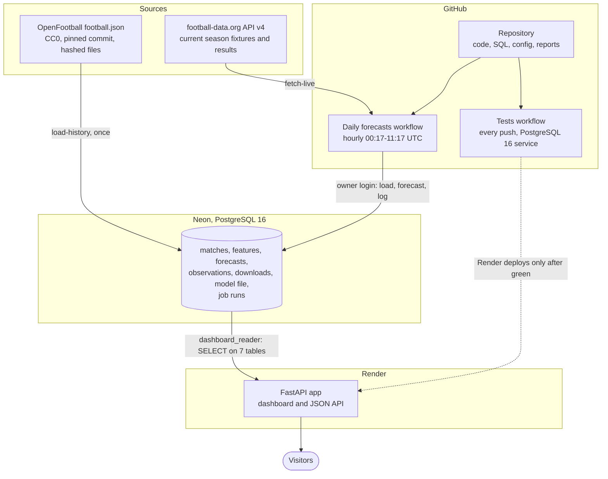

Architecture
============

How the parts fit together, how data moves through them, and why they are built this way. Commands are in [OPERATIONS.md](OPERATIONS.md); model results are in [EVALUATION.md](EVALUATION.md).

## Components

| Component | Role | Notes |
| --- | --- | --- |
| Python package `soccer_forecasting` | Every step, as commands: `python -m soccer_forecasting <command>` | Plain functions taking a database connection, so tests run them directly |
| PostgreSQL (Neon) | The single store: history, live observations, features, model runs, forecasts, job runs, raw downloads, the model file | Schema changes are numbered migrations applied by `init-db` |
| GitHub Actions: Daily forecasts | Download, load and forecast each morning | Starts on an empty computer each time; the database is its only memory |
| GitHub Actions: Tests | The whole suite on every push and pull request | Uses no secrets |
| Render | Serves the dashboard and API | Starts only the API module, with a read-only login |

## The daily job

1. **Apply migrations** (`init-db`): normally reports that the schema is up to date.
2. **Skip if done** (`daily --if-needed`): if a daily run already succeeded for today's London date, stop. GitHub starts scheduled runs late or skips them, so twelve runs are scheduled each morning and only the first to start does the work.
3. **Download** (`fetch-live`): two API requests, saved as a snapshot folder with a manifest of URLs, times and SHA-256 hashes.
4. **Load** (`load-live`), in one transaction per snapshot: verify hashes, store the raw files, upsert fixtures, record every fixture's state in `match_observations`, refuse any change to a completed result, then run the data checks. Any failure rolls the whole snapshot back.
5. **Forecast** (`forecast_day`): for today's fixtures not yet kicked off, compute features as of now, load the recorded model, and save the forecasts unless a rule blocks them (below).
6. **Log**: a `job_runs` row records success or failure, with the error message.

## Data model

| Table or view | Grain | Purpose |
| --- | --- | --- |
| teams, team_aliases | one club; one provider name or id per club | Canonical clubs, and the mapping from OpenFootball names and football-data.org ids |
| source_files | one loaded file | Provenance: provider, commit or snapshot, path, SHA-256, size, retrieval time |
| matches | one league fixture in one season | Teams, date, kickoff, status, final score; a rescheduled match stays one row |
| team_matches (view) | one team in one completed match | Each match seen from both sides, the shape window functions need |
| team_form_snapshots | one side of one fixture, per feature version | Saved historical features; never overwritten with a different value |
| fixture_features (view) | one fixture, per feature version | Home and away features side by side, without result columns |
| provider_matches | one provider match id | Ties football-data.org ids to fixtures |
| match_observations | one fixture as seen in one download | Every state ever downloaded |
| result_first_seen (view) | one completed fixture | When its result was first downloaded: the live availability time |
| model_runs | one trained model file | Settings, training seasons, data fingerprint, package versions, file hash |
| model_files | one model run | The model file itself; its hash must match model_runs (enforced by a foreign key on a generated hash column) |
| predictions | one forecast for one match, by one model, for one match day | Three probabilities, cutoffs, generation time, data snapshot; never updated |
| prediction_results (view) | one forecast | The forecast next to the result and its log loss |
| job_runs | one run of a job | Status, timing, details or error |
| live_download_files | one file of one download | The raw responses, kept privately; hashes computed by the database |

The schema lives in [sql/001_schema.sql](../sql/001_schema.sql) to [sql/005_stored_files.sql](../sql/005_stored_files.sql), with the reasoning for each table in comments.

## Time and leakage

Four kinds of time are kept apart: when a match was played (event time), when its result could be known (availability), when this project downloaded it (retrieval), and when a forecast was made (prediction time).

- **Feature cutoff.** A forecast for match day D uses only matches dated D−2 or earlier, the same rule for history and live. The feature query finds each team's latest match on or before the cutoff with a LATERAL join, then reads rolling averages computed by window functions over each team's matches, so nothing after the cutoff (including the fixture itself) can enter.
- **Availability, live.** A live result counts only if `result_first_seen` is at or before the forecast time. Historical results have no publication time, so for them the two-day buffer is a stated assumption.
- **One query for both.** Training features and live features come from the same SQL file; a test checks that the live path reproduces saved historical features exactly.
- **Rules before saving.** A forecast is saved only on match day (London date), before kickoff, when the newest download is under 30 hours old and no earlier fixture is still missing its result. Otherwise nothing is saved and the run is logged as failed, rather than producing a quietly wrong forecast.
- **Records, not recomputations.** Forecasts are never updated, the API never recomputes one, and the database refuses a forecast generated at or after kickoff. If a match moves, the old forecast stays and the new day gets its own.

## Security

| Concern | Measure |
| --- | --- |
| Secrets in a public repository | `.env` is ignored by Git. The database address and API key are GitHub secrets, given only to the two steps that need them and never placed on a command line. GitHub masks them in logs, and the code never prints them (tested). |
| A leaked dashboard password | The dashboard's login, `dashboard_reader`, is created with SQL: on Neon, roles created in the console can read and write everything. It may only SELECT 7 tables and views, and a test proves it cannot write, create tables, or read the raw downloads even with its read-only setting switched off. Running the command again changes the password. |
| What visitors can learn | Error responses say "database unavailable" without host, user or error details, which go to the server log. All team names are HTML-escaped on the dashboard. |
| Supply chain | Actions are pinned to full commit hashes, the workflows have read-only repository permissions, and direct dependencies are pinned to exact versions. |
| Bad data | Hash checks on every file. A completed result can never change silently. Unknown teams or statuses stop the load. Post-load SQL checks roll back a snapshot that breaks a rule. |

## Reliability and cost

- **Late or missing scheduled runs:** twelve morning runs, each harmless when the work is already done.
- **Failures are visible:** a red run on GitHub (and an email, with notifications on), a failed row in `job_runs`, and the dashboard's freshness badge turns from "data ok" to "stale".
- **Free plans:** GitHub Actions is free for public repositories. Neon gives 1 GB of storage and 100 compute-hours a month; the database sleeps after 5 idle minutes, and Render's health checks never touch it. Render gives 750 instance-hours a month; the service sleeps after 15 quiet minutes.
- **Storage:** one download a day, about 56 KB of raw files and 380 observation rows, keeps the database well within 1 GB for several seasons.
